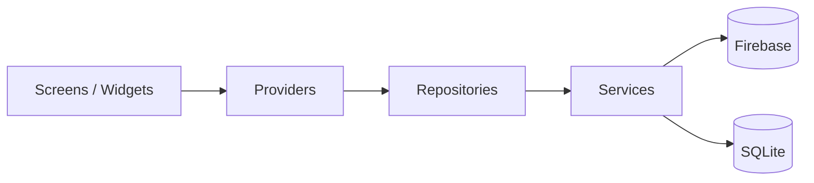

# CartMate


A Flutter e-commerce app with Firebase: browse by category or brand, add products to a cart or wishlist, and place orders.

Built as a bachelor thesis project.

## Features

- **Authentication**: sign up, log in and reset your password with email/password (Firebase Auth)
- **Home**: featured categories, a banner carousel and product search
- **Store**: browse products by category and by brand
- **Product details**: image gallery and size selection
- **Wishlist**: stored per user in Firestore
- **Cart**: stored locally with SQLite, so it survives app restarts
- **Checkout and order history**: orders are stored per user in Firestore
- **Profile**: edit name, username, phone number, date of birth and gender
- **Localization**: all UI strings come from ARB files (`flutter gen-l10n`)

## Try it

Download the latest APK from the [Releases page](https://github.com/mdrgBlg/cartmate/releases) and install it on an Android device. You may need to allow installs from unknown sources.

## Tech stack

- Flutter 3.35 / Dart
- Provider (`ChangeNotifier`) for state management
- Firebase: Auth, Cloud Firestore, App Check
- sqflite for the local cart
- cached_network_image for product images
- intl and Flutter's l10n tooling for localization

## Architecture

The app is split into a presentation layer (screens with their own providers) and a data layer (repositories and services):



- **Services** talk to Firebase or SQLite and return a sealed `Result<T>`: either `Success` with data or `Failure` with an exception ([`lib/data/models/result.dart`](lib/data/models/result.dart)).
- **Repositories** wrap the services and are what providers use.
- **Providers** hold screen state (loading, error, data) and are created close to the screen that owns them.
- **Dependency injection** uses constructor injection. Services and repositories are registered once in [`lib/app_dependencies.dart`](lib/app_dependencies.dart).

## Project structure

```
lib/
├── core/                  # l10n (ARB + generated code), styles, shared widgets
├── data/                  # services, repositories and the Result type
├── models/                # data models (products, brands, categories, cart, orders, user)
├── screens/               # auth and app screens, each with its own providers and widgets
├── utils/                 # constants, extensions, navigation and UI helpers
├── app_dependencies.dart  # service and repository registration
└── main.dart              # Firebase init and app entry point
```

## Getting started

1. Install [FVM](https://fvm.app/), then install the project's Flutter version (from `.fvmrc`):
   ```bash
   fvm install
   fvm flutter pub get
   ```
2. Connect your own Firebase project:
   ```bash
   dart pub global activate flutterfire_cli
   flutterfire configure
   ```
   This regenerates `lib/firebase_options.dart` and `android/app/google-services.json`.
3. In the Firebase console:
   - Enable **Email/Password** sign-in in Authentication.
   - Create a **Cloud Firestore** database and add these collections:
     - `Products`: `productName`, `price`, `discount`, `currency`, `stock`, `categoryId`, `productImage` (array of image URLs), `productSize` (array), `brand` (map with `id`, `brandName`, `iconName`, `productCount`)
     - `Categories`: `categoryName`, `iconName`, `isFeatured`, `parentId`
     - `Brands`: `brandName`, `iconName`, `productCount`
   - The `Users` collection, with each user's orders and wishlist, is created by the app on sign-up.
4. Run the app:
   ```bash
   fvm flutter run
   ```

### App Check

- **Debug builds** use the debug provider. Run with a fixed token:
  ```bash
  fvm flutter run --dart-define=APP_CHECK_DEBUG_TOKEN=<token>
  ```
  and register that token in Firebase console → App Check → Apps → Manage debug tokens (for both the Android and iOS apps).
- **Release builds** use Play Integrity (Android) / App Attest (iOS). These only pass for Play-distributed or App Store/TestFlight builds, so this project keeps App Check in monitor mode (not enforced).

## Running tests

```bash
fvm flutter test
```

<!--
## Screenshots

TODO: add screenshots
-->
